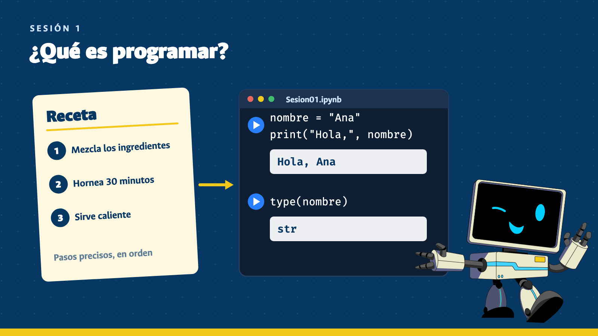
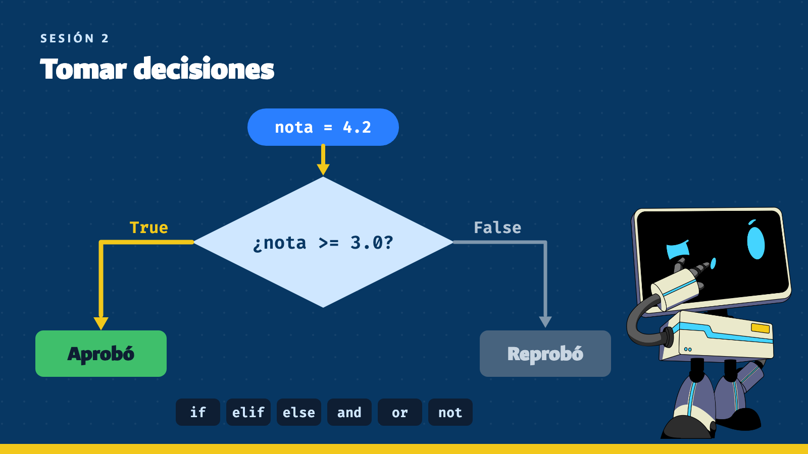
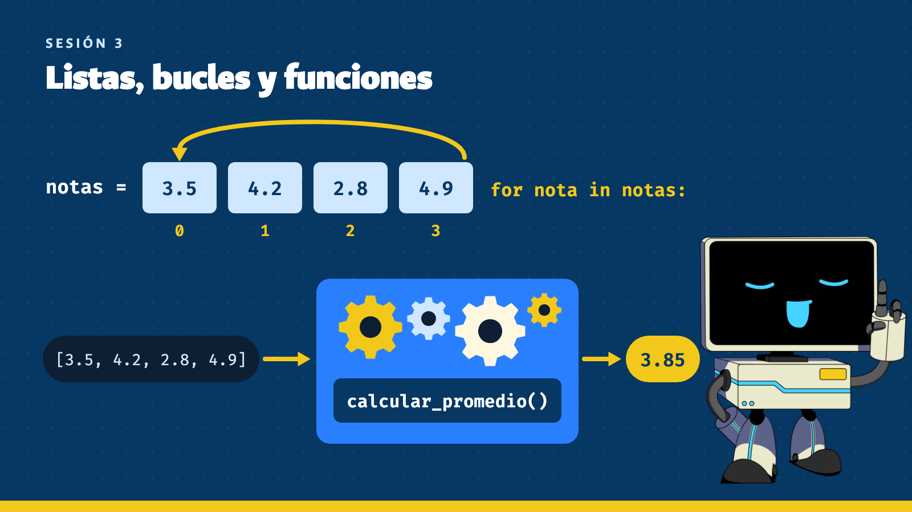
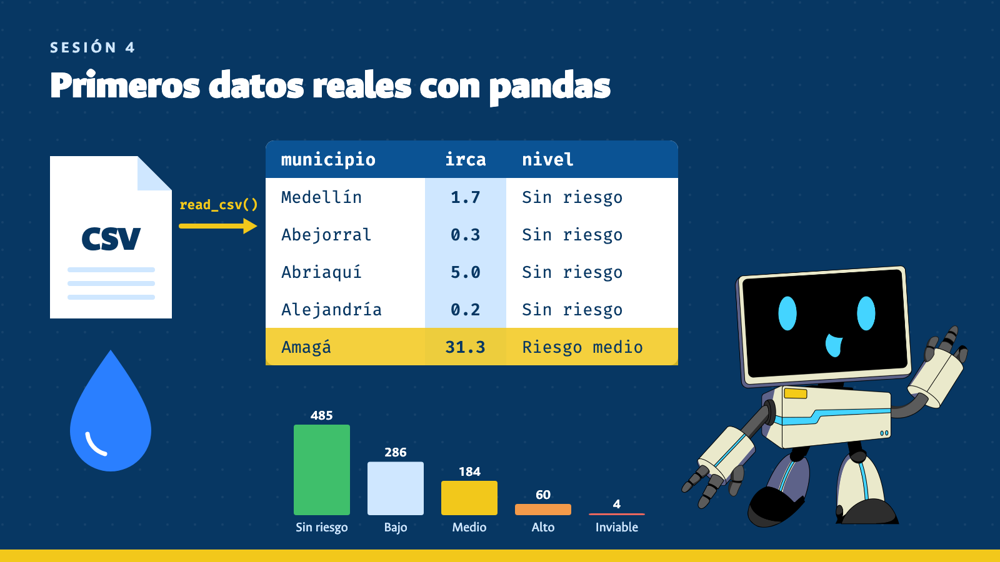
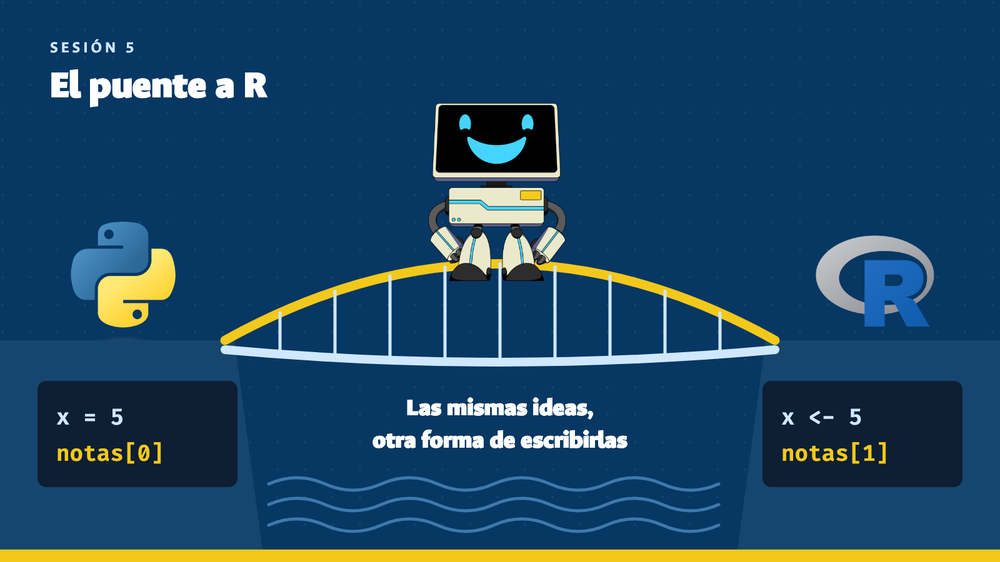
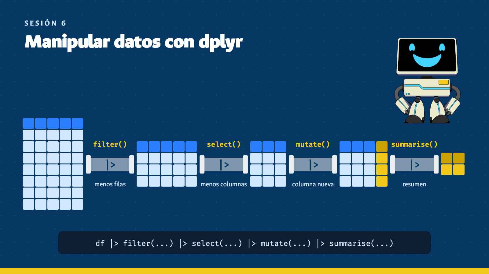
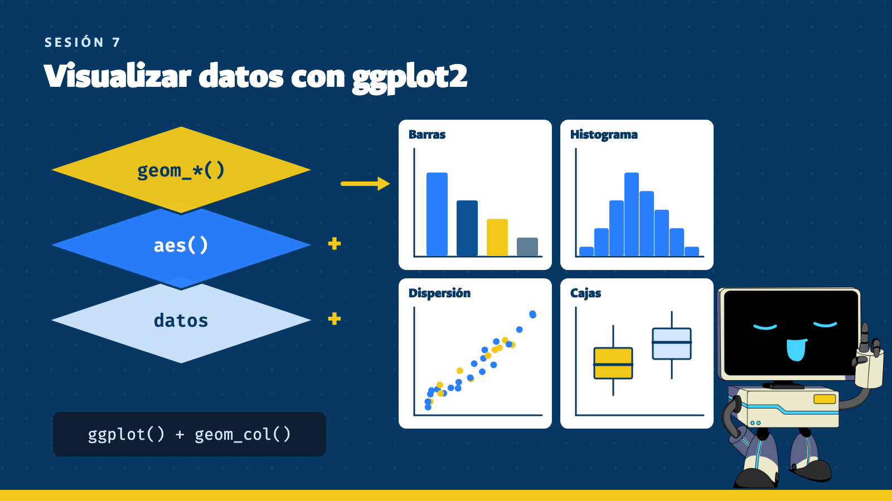
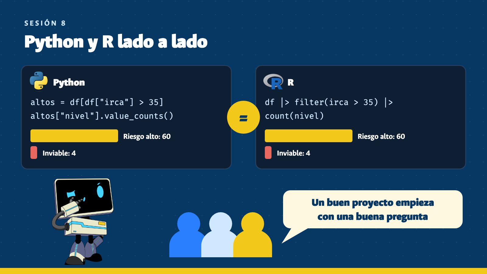
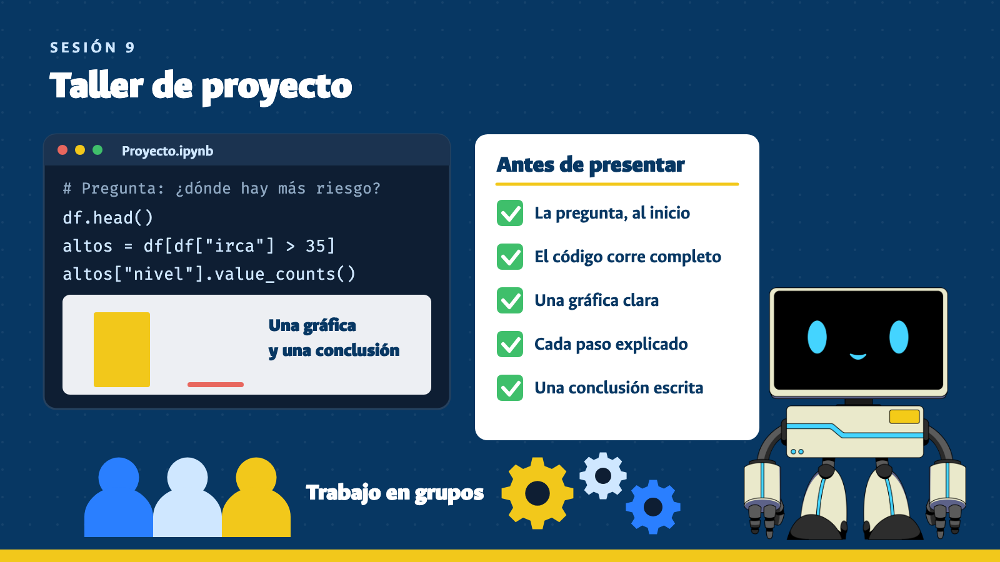
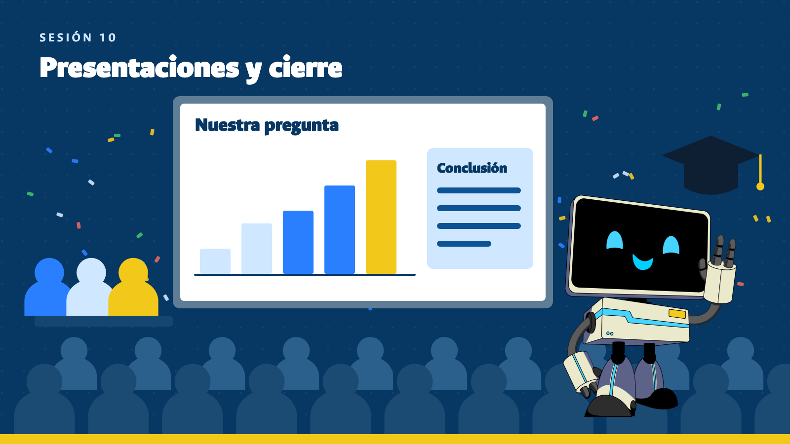

# Resumen de las sesiones

Curso libre *Introducción a la Programación en Python y R*: 10 sesiones de 2 horas, de los primeros pasos con Python a un proyecto propio de análisis de datos.

## Sesión 1: ¿Qué es programar? Primeros pasos con Python

**Temas abordados:**

- Qué es un programa y cómo lo ejecuta el computador
- Google Colab y los notebooks
- `print()`, variables y tipos de datos: `int`, `float`, `str` y `bool`
- Operaciones aritméticas
- Lectura de mensajes de error

**Descripción:** primer contacto con la programación a partir de la analogía de una receta: instrucciones precisas y en orden. Se escribe el primer código en Google Colab y se aprende a leer los errores sin miedo.

## Sesión 2: Tomar decisiones: condicionales y lógica

**Temas abordados:**

- Operadores de comparación y valores `True` y `False`
- Decisiones con `if`, `elif` y `else`
- Condiciones combinadas con `and`, `or` y `not`
- Indentación en Python
- Entrada del usuario y conversión de texto a número con `int()` y `float()`

**Descripción:** los programas dejan de seguir un único camino y empiezan a decidir según los datos. Se practica con casos cotidianos, como saber si una nota aprueba o calcular un descuento.

## Sesión 3: Listas, bucles y funciones

**Temas abordados:**

- Listas: crearlas, leer posiciones desde 0, `len()` y `append()`
- Bucle `for` y `range()`
- Acumuladores y contadores
- Funciones con `def` y `return`
- Combinación de listas, bucles y condicionales

**Descripción:** se aprende a trabajar con muchos datos sin repetir código: guardarlos en listas, recorrerlos con bucles y empaquetar las soluciones en funciones reutilizables.

## Sesión 4: Primer contacto con datos reales: pandas

**Temas abordados:**

- Datasets: filas como observaciones y columnas como variables
- Archivos CSV y DataFrames con `read_csv()`
- Exploración con `head()`, `shape`, `columns` e `info()`
- Selección de columnas y filtros de filas
- Resúmenes con `mean()` y `value_counts()`
- Una gráfica de barras

**Descripción:** el curso pasa de las listas a las tablas con un dataset real: el Índice de Riesgo de la Calidad del Agua (IRCA) de los municipios de Colombia en 2025. Con pocas líneas de pandas se leen, filtran, resumen y grafican esos datos.

## Sesión 5: El puente a R: lo mismo, en otro idioma

**Temas abordados:**

- Qué es R y para qué se usa
- RStudio en Posit Cloud
- Variables, tipos, condicionales, bucles y funciones en R
- Asignación con `<-` e indexación desde 1
- Vectores y vectorización
- Lectura del dataset del curso en R

**Descripción:** las ideas aprendidas en Python se traducen a R para mostrar que la lógica se mantiene y solo cambia la forma de escribirla. También se introducen los vectores, que muchas veces hacen innecesarios los bucles.

## Sesión 6: Manipulación de datos con dplyr

**Temas abordados:**

- Paquetes y `tidyverse`
- Los verbos `select()`, `filter()`, `arrange()` y `mutate()`
- Resúmenes con `group_by()`, `summarise()` y `count()`
- Encadenamiento de pasos con el pipe `|>`

**Descripción:** los verbos de dplyr permiten transformar el dataset y encadenar los pasos como en una receta. Cada estudiante retoma las preguntas que escribió en la sesión 4 y empieza a responderlas con código.

## Sesión 7: Visualización de datos con ggplot2

**Temas abordados:**

- Cómo elegir una gráfica según la pregunta
- La estructura de ggplot2: datos, `aes()` y `geom_*()`
- Gráficas de barras, histogramas, dispersión y cajas
- Títulos, etiquetas, colores y `facet_wrap()`
- Combinación de dplyr y ggplot2
- Estadística descriptiva básica

**Descripción:** los datos se convierten en gráficas construidas por capas, y cada tipo de gráfica se elige según la pregunta que se quiere responder. La sesión incluye estadística descriptiva y criterios para que una gráfica se entienda.

## Sesión 8: Python y R lado a lado, y formación de grupos de proyecto

**Temas abordados:**

- El mismo análisis completo en Python y en R
- Qué es igual y qué cambia entre los dos lenguajes
- Cuándo conviene usar cada uno
- Cómo formular una pregunta que se pueda responder con datos
- Rúbrica del proyecto final y formación de grupos

**Descripción:** comparar ambos lenguajes en un mismo análisis muestra que el concepto se mantiene y cambia la sintaxis. La sesión termina con los grupos formados y una pregunta de investigación para el proyecto final.

## Sesión 9: Taller de proyecto

**Temas abordados:**

- Trabajo autónomo: leer, explorar, filtrar, resumir y graficar
- Mini clase de refuerzo según lo que necesite el grupo
- Solución de errores con los mensajes y la documentación
- Estructura del proyecto y lista de verificación
- Revisión cruzada entre grupos y borrador de la presentación

**Descripción:** sesión práctica en la que cada grupo desarrolla su análisis con acompañamiento del docente. El objetivo es terminar con un análisis funcional, al menos una gráfica y un borrador de presentación.

## Sesión 10: Presentaciones de proyectos y cierre del curso

**Temas abordados:**

- Comunicación de un análisis a una audiencia no técnica
- Retroalimentación entre pares
- Recorrido por lo aprendido
- Rutas y recursos para seguir aprendiendo
- Evaluación del curso

**Descripción:** cada grupo presenta su proyecto, de la pregunta a la conclusión, y recibe preguntas y comentarios. El curso cierra con un recorrido por lo aprendido y opciones para seguir practicando.
